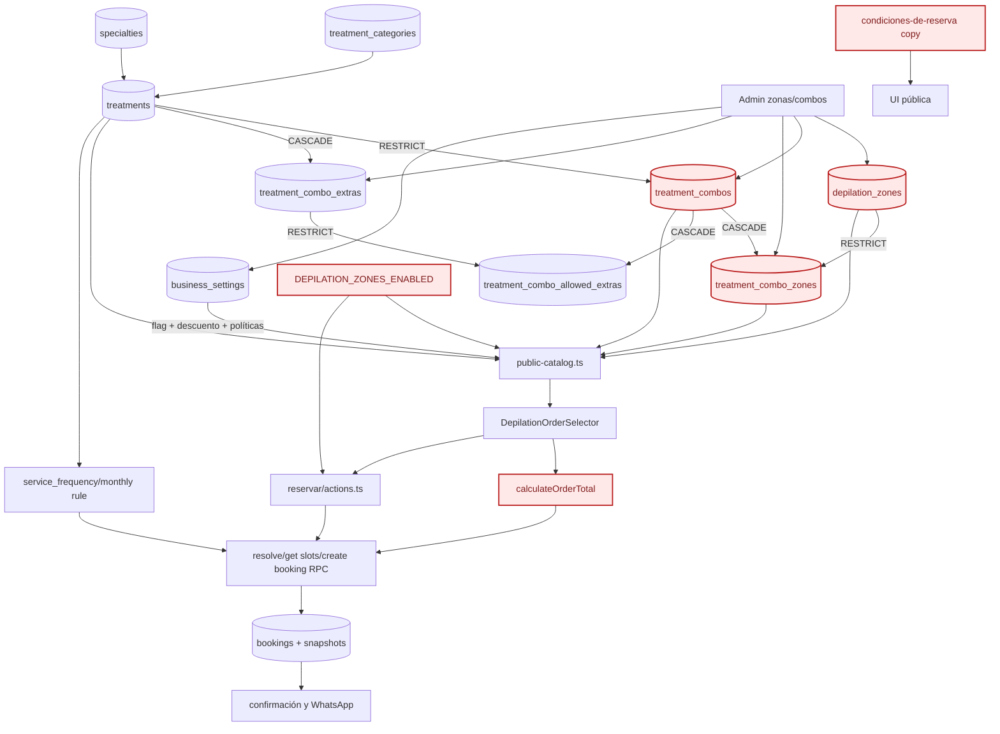

# Sprint 0 — inventario y mapa de dependencias de Depilación

Fecha de captura: **2026-10-28 01:32:57 (America/Argentina/Buenos_Aires)**  
Proyecto Supabase: `dlrdlwjighvcyhirwgfu`  
Modo de captura: exportación lógica mediante consultas `SELECT` de solo lectura.

Este documento describe el estado observado. No normaliza nombres, precios, duraciones ni relaciones. El inventario completo y verificable está en [`baseline.json`](./baseline.json); las 1.945 coincidencias del grep exhaustivo están en [`grep-inventory.tsv`](./grep-inventory.tsv).

## 1. Inventario de producción

### Tratamiento padre

| Campo | Valor exacto |
|---|---|
| ID | `a1f1196c-ff98-4a7b-86d6-355d3273944b` |
| Nombre / slug | `Depilación Láser` / `depilacion` |
| Estado | publicado (`is_active=true`) |
| Modo | `combo_with_extras` |
| Grupo de catálogo | `depilation` |
| Es combo | `false` |
| Categoría | `10000000-0000-4000-8000-000000000001` — Estética (`estetica`) |
| Especialidad | `a06a4601-5696-4b75-90c0-4fa81f20cc38` — Estetica Corporal |
| Profesional principal | `f3a29216-96e8-4d57-bbc2-cb3029ad22c2` |
| Precio base | `0` centavos; el valor se resuelve por combo/zona |
| Duración / buffer / intervalo | 60 / 5 / 30 minutos |
| Frecuencia | `monthly` |
| Regla mensual | día `4` (jueves), ordinal `[3]` (tercer jueves) |
| Orden | `1` |
| Imagen | `treatments/a1f1196c-ff98-4a7b-86d6-355d3273944b/5b85b047-5ddd-4bcf-bdd8-eacd853ef065.webp` |

Todos los textos descriptivos, preparación, contraindicaciones, características y expectativas se preservan completos en `baseline.json`; no se duplican aquí para evitar dos fuentes manuales.

### Zonas

Hay **21 zonas**, todas activas, con precio y duración positivos. Los importes se almacenan en centavos (por ejemplo, `1800000` equivale a ARS 18.000). No existe una columna de pertenencia al tratamiento en `depilation_zones`: son un catálogo global consumido por los combos y por la selección pública.

| ID | Nombre | Público | Precio centavos | Min | Orden |
|---|---|---:|---:|---:|---:|
| `0ed13aa8-bc16-4e09-b84c-eda9bf1804ab` | Medio brazos Hombres | sí | 2400000 | 10 | 0 |
| `0f71e9e9-d2d4-45e8-8255-f79eabfc91c7` | dedos de los pies | sí | 1200000 | 5 | 0 |
| `1e48f9dc-8055-469b-988e-6714bafebd8f` | Medio brazos | sí | 2000000 | 10 | 0 |
| `215a59e8-da56-4739-b87c-4fe179466c7d` | Axilas | sí | 1800000 | 10 | 1 |
| `21aed588-17c9-481d-ba12-8ef5d38405fc` | Abdomen | sí | 2000000 | 10 | 0 |
| `21b19e9e-e382-4208-9478-2a7773a848d4` | Axilas Hombres | sí | 2000000 | 10 | 0 |
| `4132c421-2e34-46c5-9348-910636a109f5` | Media espalda Hombres | sí | 2500000 | 10 | 0 |
| `4254836a-a560-4baa-914e-daacff3a1fb2` | Brazos completos | sí | 2500000 | 15 | 0 |
| `5ca3117b-0987-4f7e-8303-a4fd43869635` | Bozo o mentón | sí | 1200000 | 5 | 1 |
| `5d4fde01-e57f-4a89-be25-394ad21a64e0` | Piernas completas | sí | 3000000 | 15 | 0 |
| `63db7a14-d6f8-46a1-8e57-ba3bd7d5712f` | Cavado | sí | 2000000 | 10 | 1 |
| `9b940ab3-0e4b-4e36-bf05-98020eea2c58` | Hombros | sí | 1500000 | 10 | 0 |
| `b62c2456-482f-4377-b6dc-9a0f7f6cf83d` | Piernas completas Hombres | sí | 3500000 | 15 | 0 |
| `b72ae176-dc48-4854-8f76-a92b64741ae7` | Espalda completa | sí | 3000000 | 10 | 0 |
| `cd538350-a637-497f-854e-12408a49ef57` | Tira de cola Hombres | sí | 1200000 | 10 | 0 |
| `e1b68069-e84e-471e-94c2-32ba04d36ef7` | Brazos completos Hombres | sí | 3000000 | 15 | 2 |
| `e254e641-2f7e-4c43-ab1a-a7f881fd9f4d` | Tira de cola | sí | 1200000 | 5 | 0 |
| `e3b4c07e-6e5a-4cbe-839d-683638fba0ef` | Pecho | sí | 2000000 | 10 | 0 |
| `e5cb3e1d-9d12-417f-a0da-b4f25e41029a` | Media piernas | sí | 2300000 | 10 | 0 |
| `e9355773-7ba4-4423-bc11-8433248c23c6` | Glúteos | sí | 2000000 | 10 | 0 |
| `feb28135-531d-44a2-8f4c-9ba5dcfec0bd` | Media espalda | sí | 2000000 | 10 | 0 |

La visibilidad efectiva requiere simultáneamente: `is_active=true`, `reference_price_cents>0`, la bandera de negocio activa y que las policies públicas permitan leer el registro.

### Combos y relaciones combo-zona

Hay **14 combos**, todos activos, de una sesión, con precio fijo propio y duración manual. Todos tienen `display_order=0` y `allow_public_extras=false`.

| ID | Nombre | Precio centavos | Min | IDs de zonas incluidas |
|---|---|---:|---:|---|
| `0733767c-3781-43a3-a4ae-211cfb789f73` | Combo Hombres 2 | 4500000 | 20 | `63db7a14`, `e9355773`, `cd538350` |
| `15c8e560-7c9b-4032-921f-21661909fb9d` | Combo Mujeres 8: rostro completo | 2500000 | 10 | `5ca3117b` |
| `37eb9120-69f8-4468-94c3-22c39020c2bd` | Combo Hombres 4 | 3500000 | 15 | `21aed588`, `e3b4c07e` |
| `7cbdf019-c16e-41bb-89e5-d0a80dd0ef13` | Combo Mujeres 2 | 4800000 | 25 | `215a59e8`, `5ca3117b`, `63db7a14`, `5d4fde01`, `e254e641` |
| `82ba4fe4-6a03-4361-a9c1-53945f50700c` | Combo Mujeres 1 | 4500000 | 20 | `215a59e8`, `63db7a14`, `5d4fde01`, `e254e641` |
| `a1a20dda-90a6-426d-af86-ccf1aecda49f` | Combo Mujeres 5 | 4200000 | 20 | `215a59e8`, `63db7a14`, `e5cb3e1d`, `e254e641` |
| `a314d147-e3e8-4f38-8754-f1640d38f02a` | Combo Hombres 5 | 4500000 | 15 | `21b19e9e`, `b62c2456` |
| `a485a5ff-ae67-4df7-a805-fa74daf02ad6` | Combo Mujeres 3 | 3300000 | 15 | `215a59e8`, `63db7a14`, `e254e641` |
| `a4a861d8-1dd9-41a9-87ab-96bb0e79166d` | Combo Hombres 6 | 5800000 | 30 | `21aed588`, `e1b68069`, `b72ae176`, `9b940ab3`, `e3b4c07e` |
| `a8f68c28-17cc-42d1-a43c-a8d5d5077e45` | Combo Hombres 3 | 5000000 | 25 | `21aed588`, `b72ae176`, `9b940ab3`, `e3b4c07e` |
| `b919441e-47e2-40d0-b2a0-732dd3cdc32e` | Combo Hombres 1 | 4500000 | 20 | `21aed588`, `b72ae176`, `e3b4c07e` |
| `caee024d-a6e2-413d-bd6c-4b30bb4f2005` | Combo Mujeres 4 | 2500000 | 10 | `63db7a14`, `e254e641` |
| `deade7e7-c242-46d9-b54d-19c54b170da8` | Combo Mujeres 7 | 5800000 | 30 | `215a59e8`, `5ca3117b`, `4254836a`, `63db7a14`, `5d4fde01`, `e254e641` |
| `f6cf07ec-76bd-4d02-9b8b-8d2b49b3f500` | Combo Mujeres 6 | 4200000 | 15 | `215a59e8`, `63db7a14`, `5d4fde01` |

Los identificadores anteriores están abreviados solo en la columna de relaciones. La lista completa de 47 pares `combo_id`/`zone_id` está en `baseline.json` bajo `depilation.comboRelations`.

### Extras históricos

Existen **20 registros** en `treatment_combo_extras`: 19 activos y 1 inactivo (`1c8d10e1-0450-42c0-9abf-afa0e1715c8b`, Piernas completas). No existe ninguna fila en `treatment_combo_allowed_extras` y todos los combos tienen `allow_public_extras=false`; por lo tanto, estos extras no están habilitados en el flujo público actual. Sus IDs, nombres, precios y duraciones se conservan íntegros en `baseline.json`.

### Reservas y snapshots

| Alcance | Conteo / estado |
|---|---|
| Reservas totales | 5 |
| Rango | 2026-10-20 18:15 a 2026-10-29 17:00 (-03:00) |
| Estados | 5 `expired` |
| Reservas de Depilación | 2 |
| Referencias rotas | 0 |

- `12fe2199-c0e6-490a-ad5e-5bb2df1bcec5`: zona suelta `0f71e9e9-d2d4-45e8-8255-f79eabfc91c7`, sin combo, snapshot presente, precio aplicado 600000 centavos, 5 minutos, descuento 0.
- `550ace65-e664-483c-a746-c32af1524517`: combo `a1a20dda-90a6-426d-af86-ccf1aecda49f` más una zona adicional; snapshot presente, precio aplicado 4700000 centavos, 20 minutos, descuento 0.

No se exportó PII a esta documentación. Los archivos de respaldo ignorados por Git sí contienen las filas completas y deben tratarse como material sensible.

### Configuración y políticas

| Ajuste | Valor actual |
|---|---|
| Selector de Depilación | activo |
| Descuento global | 5 % |
| Anticipación máxima | 45 días |
| Aviso mínimo | 180 minutos |
| Caducidad de pendiente | 120 minutos |

- Seña: 50 %; pago dentro de 24 h; efectivo o transferencia; alias `pielcanela.estetica`; Mercado Pago, Agustina Spertino.
- Cancelación: una reprogramación con 48 h; cancelación no reintegrable; permite transferir la seña a otra persona avisando previamente.
- Ausencia: no reintegrable por ausencia o llegada tarde.
- Condiciones de paquetes: `null`.

El texto completo exacto está en `baseline.json`. Hay una ambigüedad importante: la política guardada permite transferir la seña en general y no limita esa regla a Depilación.

### Conteos y hashes principales

| Tabla | Filas | SHA-256 lógico |
|---|---:|---|
| `treatments` | 19 | `ab7171a46592d312951e75f2164d3972ceef094e7667d8e73ed5810e4bf30c3e` |
| `depilation_zones` | 21 | `03fbcd5d51248585a34ae0ec6ef4a57c8b1d0164084c63a8e33e2697b3d51122` |
| `treatment_combos` | 14 | `201c5cdb05eccc4974c78f67f5d4b59992dfc8246a36ac29d089d9cad09c175f` |
| `treatment_combo_zones` | 47 | `a6b4a803438ee22492aaed4d7eeb34d4c20d68ffe207baf461759a2ef3fc9584` |
| `treatment_combo_extras` | 20 | `cc04618f2a5ed95dab588203887786b952a9b4c5211714cae790fa94af7847b6` |
| `treatment_combo_allowed_extras` | 0 | `4f53cda18c2baa0c0354bb5f9a3ecbe5ed12ab4d8e11ba873c2f11161202b945` |
| `bookings` | 5 | `864504f585548ff2764e886c95ad7c8090e50386dca022b08379f8498e7a5405` |
| `business_settings` | 1 | `01e70d0131f2ea64d9b65076eb19b39e3db6abd3aac9afd00d7a82d3bb008adc` |
| `site_content` | 46 | `42436c3771d3ca076b45f9df57aeb00e0dfdd3a9ec06fcc0409c61a376b53f48` |

Los 31 conteos y hashes están en `baseline.json`.

## 2. Esquema, claves y RLS

### Relaciones críticas y `ON DELETE`

- `treatment_combos.treatment_id → treatments.id`: `RESTRICT`.
- `treatment_combo_zones.combo_id → treatment_combos.id`: `CASCADE`.
- `treatment_combo_zones.zone_id → depilation_zones.id`: `RESTRICT`.
- `treatment_combo_extras.treatment_id → treatments.id`: `CASCADE`.
- `treatment_combo_allowed_extras.combo_id → treatment_combos.id`: `CASCADE`.
- `treatment_combo_allowed_extras.extra_id → treatment_combo_extras.id`: `RESTRICT`.
- `bookings.combo_id → treatment_combos.id`: `RESTRICT`.
- Las referencias de paquetes a combo/reserva son restrictivas. Actualmente no existen paquetes ni consumos.

Evidencia principal: `supabase/migrations/20260907001400_depilation_closed_combos.sql:31-79`, `supabase/migrations/20260923001800_professional_assignment_depilation_mixed.sql:83-112` y `supabase/migrations/20261020000100_depilation_zone_orders.sql:3-14`.

### Policies observadas en producción

- `depilation_zones`: lectura anónima requiere precio positivo y, por policy adicional, zona activa más `business_settings.depilation_combos_enabled=true`. Escritura solo para `authenticated` con `is_admin()`.
- `treatment_combos`: lectura anónima requiere precio fijo positivo, combo activo, tratamiento activo, modo `closed_combo` o `combo_with_extras` y bandera habilitada. Escritura solo admin autenticado.
- `treatment_combo_zones`: lectura anónima solo cuando combo, zona y tratamiento son publicables; escritura solo admin.
- `treatment_combo_extras`: lectura anónima de activos; escritura solo admin.
- `treatment_combo_allowed_extras`: lectura anónima; escritura solo admin.
- `business_settings`: lectura pública de la fila `singleton`; escritura solo admin.
- `bookings`: acceso administrativo autenticado; la creación pública ocurre por funciones controladas, no por escritura abierta de tabla.

La consulta de catálogo usa la key publicable en servidor y `fetch: { cache: "no-store" }` (`src/lib/supabase/public-server.ts:12-18`). No se encontró una service-role expuesta al cliente.

## 3. Mapa de dependencias

Los nodos rojos son frágiles porque el nombre del modelo, las tablas, la bandera o el copy están acoplados a Depilación, o porque hoy existe divergencia entre copy y comportamiento.

### Flujo actual

1. El loader público obtiene tratamiento, combos y relaciones; con la bandera activa también obtiene todas las zonas activas y con precio.
2. El selector permite combo opcional más zonas sueltas/adicionales.
3. `calculateOrderTotal` calcula subtotal, descuento, total y duración; el mínimo de descuento es 2 zonas.
4. Las acciones públicas validan payload y solicitan a PostgreSQL cotización/disponibilidad/creación.
5. PostgreSQL relee precios y duración, comprueba la agenda mensual, crea la reserva y guarda snapshots.
6. La lectura pública usa `no-store`; `/reservar` es `force-dynamic`. Las acciones administrativas revalidan rutas relevantes.

## 4. Clasificación reutilizable vs. específica

| Archivo:línea | Qué hace | Tipo | Riesgo al generalizar |
|---|---|---|---|
| `src/domain/treatment.ts:41-44` | Modos simple/combo | genérico reutilizable | bajo |
| `src/lib/depilation-order.ts:2,49` | Mínimo de 2 zonas y cálculo puro | específico de Depilación, hardcodeado | alto |
| `src/lib/supabase/depilation-order.ts:18` | Bloqueo por `DEPILATION_ZONES_ENABLED` | hardcodeado/operativo | alto |
| `src/lib/supabase/public-catalog.ts:261-320` | Carga combos y zonas relacionadas | reutilizable parcialmente | medio |
| `src/lib/supabase/public-catalog.ts:445-458` | Carga el catálogo global de zonas para todo tratamiento no simple | específico y frágil | alto |
| `src/app/(public)/reservar/actions.ts:79,133,171` | Exige `zoneOrder` si hay combo y flag | específico de Depilación | alto |
| `src/components/treatments/DepilationOrderSelector.tsx:36-124` | Interfaz de selección de combo/zonas | específico; diseño reutilizable | medio |
| `src/app/admin/catalogo/[id]/combos/page.tsx:11-23` | Admin de zonas/combos | específico de Depilación | medio |
| `src/components/admin/DepilationComboAdmin.tsx:95-123` | Flujo de carga | específico de Depilación | medio |
| `supabase/migrations/20261020000100_depilation_zone_orders.sql:20-170` | Resolución autoritativa y snapshots | específico de Depilación | alto |
| `supabase/migrations/20261024000100_treatment_monthly_schedule.sql:5-54` | Agenda semanal/mensual | genérico reutilizable | bajo |
| `supabase/migrations/20261023000100_available_booking_dates_and_catalog_groups.sql:35-36` | Asigna grupo por ID literal de Depilación | hardcodeado por ID | alto |
| `src/app/(public)/condiciones-de-reserva/page.tsx:21` | Dice que los combos no admiten zonas individuales | copy hardcodeado y desactualizado | alto |
| `src/lib/supabase/public-server.ts:12-18` | Cliente público no-cache | genérico reutilizable | bajo |

La clasificación exhaustiva de las 1.945 apariciones —incluyendo SQL, tests, JSON implícito, rutas, acciones y caché— está en `grep-inventory.tsv` con columnas `archivo:línea`, patrón, fragmento, tipo y riesgo.

## 5. Conclusión técnica

La base de agenda, snapshots, frecuencia mensual, asignación profesional y modo de selección es reutilizable. El catálogo de ítems, el RPC de cotización, la bandera de entorno, varias rutas/componentes y el mínimo de descuento siguen acoplados semántica y técnicamente a **Depilación**. Generalizar el mismo circuito a otro tratamiento no puede hacerse de forma segura cambiando solo un nombre: requiere un modelo aditivo de catálogo configurable por tratamiento y compatibilidad explícita con estos IDs históricos.

