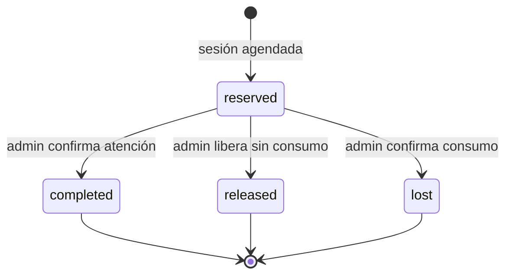

# H7 — Diseño aprobado propuesto para paquetes universales

Estado: diseño local. No contiene migraciones aplicadas ni cambios en
producción.

## Diagnóstico del circuito existente

Las tablas `customer_packages` y `package_redemptions` funcionan para el
catálogo histórico:

- `customer_packages.combo_id` es obligatorio y referencia
  `treatment_combos`;
- el trigger `activate_package_from_booking()` se activa con snapshots legacy;
- `create_admin_package_booking()` agenda sesiones incluidas;
- `set_package_session_consumption()` registra consumo o devolución;
- `extend_customer_package()` extiende vigencia con motivo;
- RLS: solo `authenticated` con `is_admin()`; anónimos sin acceso.

Ese modelo no puede alojar un paquete universal de
`treatment_option_combos` sin relajar una FK/NOT NULL existente. Hacerlo violaría
el contrato no destructivo. Por eso H7 conserva íntegro el circuito legacy y
propone objetos neutrales nuevos.

## Modelo aditivo propuesto

### Configuración vendible

Agregar a `treatment_option_combos`, solo para filas `kind='package'`:

- `package_rules jsonb null` — reglas propias de esa propuesta;
- `package_rules_version smallint null` — inicialmente `1`.

Los valores por defecto del tratamiento viven en
`booking_config.packageDefaults`. La opción vendible hereda esos valores en el
editor y guarda una copia completa; ninguna regla operativa queda implícita en
el código.

Agregar a `business_settings`:

- `default_deposit_percent numeric(5,2) null check between 0 and 100`.

No reemplaza `deposit_text`. Si tanto la regla del paquete como el valor general
son nulos, el sistema informa “seña a coordinar” y no inventa un porcentaje.

### `service_package_contracts`

Contrato de compra universal, separado de `customer_packages`:

- IDs: `id`, `customer_id`, `treatment_id`, `offering_id`,
  `initial_booking_id` único;
- snapshot comercial: nombre, precio total, precio por sesión, duración,
  sesiones totales;
- `rules_snapshot jsonb not null` y `rules_version`;
- vigencia: `validity_starts_from`, `validity_starts_at`, `validity_until`;
- pago manual: `deposit_pending | deposit_paid | paid_in_full` y fecha;
- estado: `active | completed | expired | suspended`;
- `created_by`, motivo y timestamps.

Agregar a `bookings` una FK nullable nueva `service_package_id`. La FK legacy
`customer_package_id` permanece intacta.

### `service_package_sessions`

Una fila por sesión del contrato:

- `package_id`, `booking_id` único, `session_number` único por paquete;
- estado `reserved | completed | released | lost`;
- resultado sugerido y resultado confirmado;
- marca de excepción, motivo obligatorio y actor;
- número de reprogramaciones congelado al decidir;
- clave de idempotencia única;
- timestamps.

El saldo se deriva dentro de la RPC:

`total - (reserved + completed + lost)`.

`released` no consume saldo. El valor nunca se persiste como contador editable,
evitando desincronizaciones.

## Reglas congeladas

Esquema Zod y JSON v1:

- `sessionsCount`;
- `validityDays`;
- `validityStartsFrom: purchase | first_session`;
- `minDaysBetweenSessions` nullable;
- `releaseNoticeHours`;
- `maxReschedulesPerSession`;
- `absenceConsumesSession`;
- `lateReleaseConsumesSession`;
- `depositPercent` nullable;
- `conditionsText` nullable.

Al registrar la compra, la RPC resuelve configuración de la propuesta,
defaults del tratamiento y seña general; guarda el resultado completo en
`rules_snapshot`. Los cambios posteriores no modifican contratos vendidos.

## Transiciones

No hay transición automática. El servidor devuelve una sugerencia:

- atención realizada → `completed`;
- liberación dentro del aviso → `released`;
- liberación tardía → `lost` si la regla lo indica;
- ausencia → `lost` o `released` según snapshot.

El admin confirma. Si elige otro resultado, debe informar un motivo y se crea
un evento de auditoría sin datos personales.

## RPC única de saldo

`manage_service_package_session(...)` será `SECURITY DEFINER`, con
`search_path=''`, objetos calificados y `EXECUTE` solo para `authenticated`.

Dentro de una transacción:

1. exige `is_admin(auth.uid())`;
2. bloquea contrato con `FOR UPDATE`;
3. valida vigencia, separación mínima, reprogramaciones y profesional;
4. valida idempotencia;
5. crea o cambia la sesión;
6. calcula saldo desde las filas bloqueadas;
7. rechaza saldo negativo;
8. audita una excepción si corresponde;
9. devuelve estado, sugerencia y saldo.

Dos intentos simultáneos sobre la última sesión compiten por el mismo lock: uno
gana y el otro recibe `package_has_no_sessions`.

Operaciones auxiliares:

- `register_service_package_purchase` — confirma pago, crea contrato y sesión
  inicial de forma idempotente;
- `get_service_package_slots` — reutiliza disponibilidad y profesionales;
- `extend_service_package_validity` — motivo obligatorio y auditoría;
- `suggest_service_package_outcome` — función pura/estable, sin mutación.

## Vigencia desde primera sesión

Recomendación: usar la fecha agendada de la primera sesión. Si esa primera
sesión se reprograma antes de ocurrir y todavía no existe otra sesión consumida,
la RPC mueve `validity_starts_at` y `validity_until` juntas. Después de completar
o perder una sesión, la vigencia queda congelada. Esto es previsible para
recepción y evita que una compra quede sin vencimiento.

## RLS

| Rol | Lectura | Escritura |
|---|---|---|
| anon | no | no |
| authenticated sin rol operativo | no | no |
| admin/manager activo | sí | solo RPC para cambios de saldo |

Las tablas tendrán policies propias. Se revocará escritura directa incluso al
rol operativo en `service_package_sessions`; las mutaciones de saldo pasarán
únicamente por RPC.

## Panel H9

La pantalla “Paquetes” unirá visualmente contratos legacy y universales sin
mezclar IDs:

- alta de compra desde una pre-reserva;
- pago manual y reglas congeladas visibles;
- saldo y sesiones reservadas/completadas/perdidas/liberadas;
- agenda de próxima sesión con disponibilidad real;
- cierre con sugerencia, confirmación y excepción motivada;
- vigencia y extensión;
- filtro “por vencer”.

Los formularios muestran únicamente los datos mínimos del cliente.

## Pruebas H8

- concurrencia de última sesión;
- idempotencia de compra y transición;
- saldo por propiedad, nunca negativo;
- snapshot inmutable al editar reglas;
- vigencia desde compra y primera sesión;
- separación mínima y máximo de reprogramaciones;
- todas las combinaciones de sugerencia;
- excepción auditada con motivo;
- RLS 24 celdas como mínimo;
- anon sin lectura/escritura;
- rollback exacto contra la línea base local.

## Decisiones para aprobar H7

1. **Tablas neutrales nuevas** en vez de relajar el modelo legacy — recomendado.
2. Vigencia desde primera sesión anclada a la primera fecha agendada y móvil
   solo antes del primer consumo — recomendado.
3. Manager y admin pueden operar paquetes; solo admin puede cambiar defaults
   globales — recomendado.
4. Una sesión `released` deja de ocupar saldo, pero la reserva histórica se
   conserva cancelada/liberada — recomendado.

Con estas cuatro decisiones aprobadas puede comenzar H8: SQL aditivo con
rollback, RPC transaccional y pruebas locales. Nada se aplica a producción.

